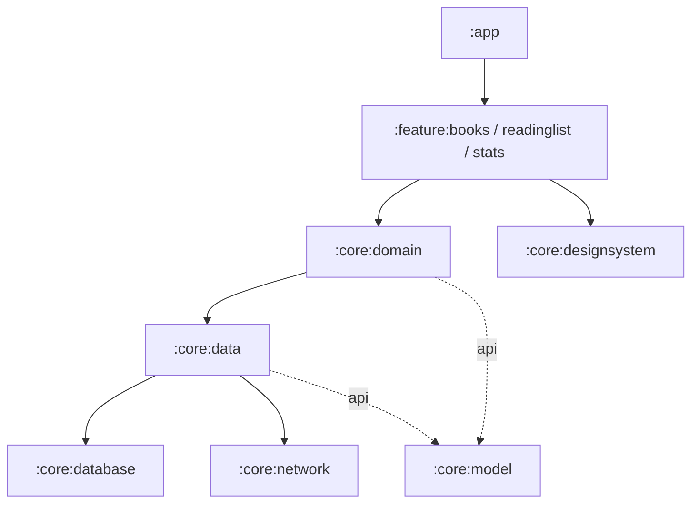

# Shelfie

A book-tracking Android app built with **Jetpack Compose**, **Hilt**, **Room 3**, **Navigation 3**
and **Retrofit**. It is a reference example of the layered, multi-module architecture Google
recommends for Android apps: offline-first data, unidirectional data flow, and module
boundaries the build enforces. See [Architecture](#architecture) for how and why.

The rules every change follows are in [`AGENTS.md`](AGENTS.md).

---

## Quick start

1. Install a recent Android Studio release that supports the Android Gradle Plugin version in
   `gradle/libs.versions.toml` (see Google's
   [AGP and Android Studio compatibility table](https://developer.android.com/build/releases/gradle-plugin#android_gradle_plugin_and_android_studio_compatibility)).
2. Open the project and let Gradle sync. Gradle itself needs JDK 17 or newer; the build compiles
   with a JDK 17 toolchain, which Gradle downloads automatically if it is missing.
3. Run the `:app` module on an emulator or device running Android 7.0 (API 24) or newer.

> The app talks to the [Open Library API](https://openlibrary.org/developers/api). Search results,
> favorites, your shelves and your stats are stored in Room, so they keep working offline after
> the first search. Opening a book's detail page fetches its description from the network, so
> that screen needs a connection.

---

## Architecture

Shelfie is meant as a worked example of the architecture Google recommends for Android apps. It
combines two pieces of official guidance:

- The [Guide to app architecture](https://developer.android.com/topic/architecture), which decides
  how code is split into **layers** (UI, domain, data).
- The [Guide to Android app modularization](https://developer.android.com/topic/modularization),
  which decides how those layers are split into **Gradle modules**.

The layout follows Google's own reference app,
[Now in Android](https://github.com/android/nowinandroid): `feature/` and `core/` modules,
plus a `build-logic` build of convention plugins.

### The principles

Google's guide rests on four principles. Each one shows up somewhere concrete in this codebase:

| Principle | What it means | Where to see it in Shelfie |
|---|---|---|
| **Separation of concerns** | Each class has one job; UI classes only display state and forward user actions | Screens render state; ViewModels hold it; use cases hold business operations; repositories own data |
| **Drive UI from data models** | The UI is a function of state objects that outlive the screen, so state survives rotation and process death | Every screen renders an immutable `UiState` held by a ViewModel |
| **Single source of truth** | Each piece of data has one owner that is the only place allowed to change it | Room owns all book data; the network only writes into Room, and the UI only reads from Room |
| **Unidirectional data flow** | State flows down to the UI, and events flow up to the owner | `UiEvent` goes up to the ViewModel, a new `UiState` comes down to the screen |

### The layers

Google recommends at least two layers, UI and data, plus an optional domain layer in between:

```
UI layer       :feature:*      Screens (Compose) + ViewModels that hold UiState
Domain layer   :core:domain    Use cases: one business operation per class
Data layer     :core:data      Repositories: the single source of truth for each kind of data
               :core:database  Room: local storage
               :core:network   Retrofit: the Open Library API
```

Google treats the domain layer as optional, for logic that several ViewModels share. Shelfie
uses it for every operation, even ones that only pass a call through to a repository. That
makes the domain layer the **only** door from the UI to data, and Gradle enforces it (see
"Boundaries the build enforces" below). It costs a few small classes; the payoff is that no
ViewModel can reach a repository, a DAO or a DTO, even by accident.

### Why split into modules

Splitting by layer only needs packages. Splitting into Gradle **modules** adds things packages
cannot provide. These are the benefits Google lists, and how each applies here:

| Benefit (Google's term) | What it gives Shelfie |
|---|---|
| **Strict visibility control** | Kotlin `internal` means "visible only inside this module". Repository implementations, mappers, `ShelfieDatabase` and every Hilt module are `internal`, so other modules can only use the public interfaces. Within a single module, `internal` would hide nothing. |
| **Encapsulation** | Each module knows as little as possible about the others. A feature module cannot even see the Room or Retrofit classes, because they are not on its compile classpath. |
| **Build time** | Gradle compiles independent modules in parallel and recompiles only what changed. Editing a screen in `:feature:stats` does not recompile `:core:database`. |
| **Testability** | Each layer is tested on its own: use cases with a mocked repository, ViewModels with mocked use cases, DAOs against an in-memory database. |
| **Scalability and ownership** | A change in one feature cannot ripple into another, because features cannot see each other. On a team, each module can have one owner. |
| **Reusability** | `:core:*` modules can be shared by another app or app flavor (a tablet or Wear OS app, say) without carrying any of Shelfie's screens. |

Google is candid that modularization has costs: more build files, and more structure to learn.
It calls modularization a necessity only when you need reusability, strict visibility control or
on-demand feature delivery, and "worth considering" otherwise. An app of Shelfie's size could
live in one module; this project is modularized to demonstrate the pattern, and the
convention plugins in `build-logic` keep the per-module cost down to a few lines each.

### Modules and folders

Google's [modularization patterns](https://developer.android.com/topic/modularization/patterns)
guide names a handful of module types: app, feature, data, common and test modules. Every
top-level folder in Shelfie is one of them. Inside each module, source lives under
`src/main/kotlin/com/shelfie/<module>/`; the tree below shortens that to `.../`.

```
shelfie/
|
|-- app/                                   APP MODULE: wires everything together
|   `-- .../app/
|       |-- ShelfieApplication.kt          @HiltAndroidApp Application
|       |-- MainActivity.kt                Single Activity: Scaffold, bottom bar, NavDisplay
|       `-- navigation/
|           |-- NavKeys.kt                 @Serializable keys: BooksNavKey, BookDetailNavKey(bookId), ...
|           |-- TopLevelNavItem.kt         The three bottom-bar tabs
|           |-- NavigationState.kt         One back stack per tab, saved across process death
|           `-- Navigator.kt               Turns navigate() / goBack() into back stack changes
|
|-- feature/                               UI LAYER: one module per feature, UI code only
|   |-- books/.../feature/books/
|   |   |-- BooksScreen.kt                 Search and favorites (BooksScreen + BooksContent)
|   |   |-- BooksViewModel.kt              Debounces the query, calls SearchBooksUseCase
|   |   |-- BooksUiState.kt                Everything the screen shows
|   |   |-- BooksUiEvent.kt                Every user action
|   |   |-- BookDetailScreen.kt            Book detail page and shelf picker
|   |   |-- BookDetailViewModel.kt         Receives bookId through assisted injection
|   |   `-- BookDetailUiState.kt
|   |-- readinglist/.../feature/readinglist/
|   |   `-- ReadingList{Screen,ViewModel,UiState,UiEvent}.kt
|   |                                      Shelves with drag-to-reorder and a progress slider
|   `-- stats/.../feature/stats/
|       `-- Stats{Screen,ViewModel,UiState}.kt
|                                          Streaks and monthly chart (read-only: no UiEvent)
|
|-- core/
|   |-- domain/                            DOMAIN LAYER: one business operation per class
|   |   `-- .../core/domain/               SearchBooksUseCase, GetShelfBooksUseCase,
|   |                                      AddToShelfUseCase, ... (12 use cases)
|   |-- data/                              DATA LAYER: single source of truth for each kind of data
|   |   `-- .../core/data/
|   |       |-- repository/                BookRepository, ReadingListRepository, StatsRepository
|   |       |                              (public interfaces); OfflineFirstBookRepository,
|   |       |                              DefaultReadingListRepository, DefaultStatsRepository
|   |       |                              (internal implementations)
|   |       |-- mapper/                    BookMapper, ReadingListMapper: network model/entity -> model
|   |       `-- di/                        DataModule: binds each interface to its implementation
|   |-- database/                          DATA SOURCE: local storage (Room 3)
|   |   `-- .../core/database/
|   |       |-- ShelfieDatabase.kt
|   |       |-- dao/                       BookDao, ReadingListDao
|   |       |-- model/                     CachedBookEntity, FavoriteBookEntity, ReadingListEntity
|   |       |-- converter/                 StringListConverter: List<String> <-> JSON
|   |       `-- di/                        DatabaseModule
|   |-- network/                           DATA SOURCE: remote API (Retrofit)
|   |   `-- .../core/network/
|   |       |-- OpenLibraryApi.kt
|   |       |-- model/                     NetworkSearchResponse, NetworkBook, NetworkWorkDetail
|   |       `-- di/                        NetworkModule: Retrofit, OkHttp, Moshi
|   |-- model/                             COMMON: plain Kotlin models every layer shares
|   |   `-- .../core/model/                Book, BookDetail, ReadingListBook, ReadingStats, Shelf
|   |-- designsystem/                      COMMON: design system (theme only, for now)
|   |   `-- .../core/designsystem/theme/   Color.kt, Theme.kt, Type.kt
|   `-- testing/                           TEST MODULE: shared test helpers
|       `-- .../core/testing/              MainDispatcherRule
|
|-- build-logic/convention/src/main/kotlin/
|   |-- ShelfieBuild.kt                    SDK levels and JVM toolchain, defined once
|   `-- shelfie.*.gradle.kts               Six convention plugins that configure every module
|-- gradle/libs.versions.toml              Every library and Gradle plugin version
`-- .github/workflows/                     CI: unit tests and DAO instrumented tests
```

Every feature follows the same pattern: a `Screen` with an internal stateless `Content`, a
`ViewModel` that owns one `UiState`, and a sealed `UiEvent` for user actions when the screen has
any.

The guide's rule of thumb for drawing these lines is **high cohesion, low coupling**: put things
that change together in one module, and keep the connections between modules few. That is why
the data layer is shared in `core/` rather than split per feature: the reading list is read by
all three features, so splitting it would force features to depend on each other.

### Naming conventions

Names follow [Now in Android](https://github.com/android/nowinandroid), so anyone who knows one
project can find their way around the other:

| Kind | Pattern | Shelfie | Now in Android |
|---|---|---|---|
| Application class | `<App>Application` | `ShelfieApplication` | `NiaApplication` |
| Room database | `<App>Database` | `ShelfieDatabase` | `NiaDatabase` |
| Room entity | `*Entity`, in `core.database.model` | `ReadingListEntity` | `TopicEntity` |
| DAO | `*Dao` | `BookDao` | `TopicDao` |
| Network model | `Network*`, in `core.network.model` | `NetworkBook` | `NetworkTopic` |
| Type converter | Named for what it converts | `StringListConverter` | `InstantConverter` |
| Repository interface | `*Repository` | `BookRepository` | `TopicsRepository` |
| Repository that syncs network into Room | `OfflineFirst*Repository` | `OfflineFirstBookRepository` | `OfflineFirstTopicsRepository` |
| Repository over local data only | `Default*Repository` | `DefaultReadingListRepository` | `DefaultRecentSearchRepository` |
| Use case | `*UseCase` | `GetShelfBooksUseCase` | `GetFollowableTopicsUseCase` |
| Navigation key | `*NavKey` | `BookDetailNavKey` | `TopicNavKey` |
| Bottom-bar tab | `TopLevelNavItem` | `TopLevelNavItem` | `TopLevelNavItem` |
| Hilt module | `*Module`, in a `di` package | `DataModule` | `DataModule` |
| Design system module | `:core:designsystem` | theme | theme, icons, components |

Feature packages skip a `.ui` segment (`com.shelfie.feature.books`), because a feature module
holds nothing but UI, and all source lives in `src/main/kotlin`.

**There is no `:core:ui` module yet.** In Now in Android, `:core:designsystem` holds
model-agnostic building blocks (theme, icons, buttons), and `:core:ui` holds composables that
render domain models (a news card, say) and are shared by several features. Shelfie has no such
composable yet, so it has no `:core:ui`. Create one when the first composable that takes a
`:core:model` type is needed by two features.

### Boundaries the build enforces

Dependencies point one way, from the app inward to the data sources:



Three rules keep the graph honest, and Gradle checks all of them at compile time:

1. **A feature never depends on another feature.** Features talk only through the app module
   (see the next section).
2. **A feature never depends on a data module.** `:core:domain` declares `:core:data` as an
   `implementation` dependency, which Gradle does not pass on. So repositories are not on a
   feature's compile classpath at all, and a ViewModel that tries to inject one does not compile.
3. **Models are the shared language.** `:core:model` is passed on as an `api` dependency, so
   every layer speaks in the same plain Kotlin types. DTOs and Room entities are converted to
   models inside `:core:data` and never leave it.

### How features talk to each other

Google's guidance for module-to-module communication is to let a third module mediate,
usually the app module that owns navigation. Shelfie does exactly that. When you tap a book in
`:feature:books` or `:feature:readinglist`, the screen calls a plain callback,
`onBookClick(bookId)`. The app module turns that into a navigation event, and the detail
screen's ViewModel receives only the ID and loads the rest itself. Passing an ID rather than a
whole object is also Google's navigation guidance: the destination fetches fresh data from the
single source of truth instead of trusting a copy.

### A request, end to end

Searching for a book touches every layer once:

1. **UI:** typing in `BooksScreen` sends a `BooksUiEvent` to `BooksViewModel`.
2. **ViewModel:** after a short debounce it calls `SearchBooksUseCase`: `observe(query)` to
   watch cached results and `refresh(query)` to fetch new ones.
3. **Domain:** the use case forwards both calls to `BookRepository`.
4. **Data:** `OfflineFirstBookRepository` calls `OpenLibraryApi`, maps the network models to Room entities and
   replaces the cached results for that query in Room.
5. **Back up:** Room notices the change and emits the new rows through the `Flow` the ViewModel
   is already observing. The repository maps them to `Book` models, and the ViewModel publishes
   a new `BooksUiState`, which the screen renders.

The network never talks to the UI directly. If the request fails, the screen keeps showing what
Room already has, which is what makes the app offline-first.

### Where Shelfie simplifies

Google's guidance scales to apps with dozens of features and teams. At Shelfie's size, two
recommendations are deliberately simplified:

- **Navigation keys live in `:app`.** For Navigation 3 in large apps, Google recommends splitting
  each feature into an `api` module (its navigation keys) and an `impl` module (its screens), so
  features can navigate to each other without depending on each other's code. With three
  features, Shelfie keeps all keys in `:app` instead; the split is worth adding when features
  start navigating to each other directly.
- **One data module for all features.** Large apps often have one data module per domain
  (books, user, settings). Shelfie's features all share one book catalog, so one `:core:data`
  keeps cohesion high.

### Build configuration

Each module's `build.gradle.kts` applies one convention plugin from `build-logic/convention`
and adds only what is specific to that module:

| Plugin | For |
|---|---|
| `shelfie.android.application` | `:app` (also applies the Compose and Kotlin serialization plugins) |
| `shelfie.android.feature` | feature modules (Compose, Hilt, the core modules, test libraries) |
| `shelfie.android.library` | Android core modules |
| `shelfie.android.library.compose` | Android modules with Compose UI |
| `shelfie.android.hilt` | any module with Hilt bindings or `@Inject` constructors |
| `shelfie.jvm.library` | pure Kotlin modules (`:core:model`, `:core:testing`) |

- **SDK levels and the JVM toolchain** are defined once, in
  `build-logic/convention/src/main/kotlin/ShelfieBuild.kt`, and every convention reads them.
- **Library and Gradle plugin versions** live in `gradle/libs.versions.toml`. Gradle plugins are
  listed there as libraries that `build-logic` depends on, so modules never declare a plugin
  version.
- **The configuration cache** is on in `gradle.properties`, so repeat builds skip the
  configuration phase.

---

## Key concepts

### Use cases

A **use case** is a small class that does *one* business operation. ViewModels call use cases
instead of calling repositories directly. This keeps ViewModel logic thin and makes each
operation testable on its own.

```kotlin
/** Observes all books on a given shelf. */
class GetShelfBooksUseCase @Inject constructor(
    private val repository: ReadingListRepository
) {
    operator fun invoke(shelf: Shelf): Flow<List<ReadingListBook>> =
        repository.observeByShelf(shelf)
}
```

Conventions in this project:

- **`operator fun invoke(...)`** lets you call the use case like a function:
  `getShelfBooksUseCase(shelf)` instead of `getShelfBooksUseCase.execute(shelf)`.
- A use case exists even when it only passes through to a repository, so every ViewModel
  depends on the same kind of thing.
- Some use cases split observation from refresh (for example `SearchBooksUseCase` exposes
  `observe()` and `refresh()`) to support the offline-first pattern.
- Every use case receives its dependencies through `@Inject constructor`, so Hilt provides them.

### The `internal` keyword

Kotlin's `internal` means "visible only inside this Gradle module." In this project:

- Repository **implementations**, mappers, `ShelfieDatabase`, the Room type converters, and every Hilt
  module are `internal`.
- Repository **interfaces**, use cases, and domain models are **public** because other modules
  need them. DAOs, entities, the Retrofit interface and network models are public too, but only
  `:core:data` depends on the modules that hold them.

If an implementation class were public, other modules could bypass its interface and depend on
concrete details, which defeats the point of the architecture.

### Offline-first data flow

Data flows **Network -> Room (local database) -> UI**:

1. The UI observes a `Flow` from Room, the single source of truth.
2. A coroutine fetches fresh data from the API and writes it into Room.
3. Room pushes the update to the UI through the same `Flow`.

The app shows cached data immediately and updates when the network responds. See
`OfflineFirstBookRepository` for a concrete example. Book detail is the exception: it is fetched from
the network each time it opens.

### Unidirectional Data Flow (UDF)

State flows in one direction through the UI layer:

```
User action  ->  UiEvent  ->  ViewModel  ->  UiState  ->  Composable
```

- **`UiEvent`**: a sealed interface with one subtype per user action (tap, type, and so on).
- **`UiState`**: an immutable data class holding everything the screen needs to render.
- The ViewModel exposes a single `StateFlow<UiState>`. The composable never changes state
  itself; it sends events to the ViewModel, which produces a new state.

Two screens are simpler: the stats screen has no user actions, so it has no `UiEvent`, and the
book detail screen calls ViewModel methods directly.

### Navigation 3

Navigation uses [Jetpack Navigation 3](https://developer.android.com/guide/navigation/navigation-3),
where the app owns its back stack as plain state:

- **Nav keys** are `@Serializable` classes implementing `NavKey`, in
  `app/src/main/kotlin/com/shelfie/app/navigation/NavKeys.kt`. Being serializable lets the back
  stack survive process death. A key with arguments is a data class, such as
  `BookDetailNavKey(bookId)`.
- **One back stack per tab.** `NavigationState` and `Navigator` (adapted from Google's
  Navigation 3 migration guide) keep a separate history for Search, Library and Stats. Switching
  tabs keeps each tab's history, and Back from a tab's first screen returns to Search.
- **`NavDisplay`** in `MainActivity` renders the current entries. Each destination is an
  `entry<Route> { ... }` block.
- **Features stay navigation-free.** A screen exposes callbacks such as `onBookClick`, and
  `:app` turns them into navigation.
- **Route arguments reach the ViewModel through Hilt assisted injection.** `BookDetailViewModel`
  takes `bookId` as an `@Assisted` constructor parameter, and the app creates it with
  `hiltViewModel<BookDetailViewModel, BookDetailViewModel.Factory>(creationCallback = { it.create(key.bookId) })`.
  A missing argument is then a compile error rather than a crash.

### Room 3

The database uses [Room 3](https://developer.android.com/training/data-storage/room), which is
Kotlin- and coroutine-first:

- Classes live in the `androidx.room3` package. Type converters are `@ColumnTypeConverter`.
- Every DAO function is a `suspend` function or returns a `Flow`.
- Room runs on an explicit SQLite driver, `AndroidSQLiteDriver`, which uses the platform's SQLite.
- The schema is not exported, and a version bump recreates the database. Shelfie is a dev app,
  so local data is disposable.

### Dependency injection with Hilt

Hilt generates the wiring, so you never create these objects by hand. Key things to know:

- **`@HiltAndroidApp`** on `ShelfieApplication` (the `Application` class) bootstraps Hilt.
- **`@AndroidEntryPoint`** on `MainActivity` lets Hilt inject into the Activity.
- **`@HiltViewModel`** on ViewModels lets Hilt provide constructor dependencies.
- **`@InstallIn(SingletonComponent::class)`** for every Hilt module. Retrofit, OkHttp, Moshi and
  Room are `@Singleton`; repository bindings are unscoped because repositories hold no state.
- Feature modules have no Hilt modules. Their ViewModels get use cases by constructor injection.
- **`@Binds`** maps an interface to its implementation (for example `BookRepository` to
  `OfflineFirstBookRepository`).
- **`@Provides`** creates instances Hilt cannot construct on its own (Retrofit, Room, and so on).

### Mappers

DTOs and Room entities never reach a composable. The `mapper/` package in `:core:data` holds
extension functions that convert between layers:

```
Network DTO  -->  Room Entity  -->  Domain Model  -->  UI
```

See `BookMapper.kt` for the pattern: each conversion is a small, pure extension function.

### Compose conventions

- Each screen has a stateless `Content(...)` composable that takes the `UiState` (plus an event
  callback `(UiEvent) -> Unit` when the screen has user actions), so previews and tests can render
  any state without a ViewModel.
- Every composable accepts a `Modifier` as its first optional parameter.
- Lists use `ImmutableList` from `kotlinx.collections.immutable`, so Compose can skip
  recomposition when the list contents have not changed.

---

## Build toolchain notes (AGP 9)

The Android Gradle Plugin 9 line differs from older tutorials you might find online:

- **No `kotlin-android` plugin.** AGP 9 has Kotlin built in, and applying
  `org.jetbrains.kotlin.android` causes a conflict. The Compose compiler plugin is still
  needed; the conventions apply it.
- **No `kotlinOptions` block.** Use a top-level `kotlin { compilerOptions { } }` block instead.
- **`BaseExtension` is removed.** Use the `androidComponents { }` DSL for variant configuration.
- **`compileSdk` includes a minor API level** (`release(37) { minorApiLevel = 2 }`), because
  current AndroidX libraries require one.

---

## Testing

### Test strategy

The project has two layers of tests, and each catches a different class of bug:

| Layer | Tools | What it tests | Where |
|---|---|---|---|
| Unit (JVM) | JUnit 4, MockK, Turbine, coroutines-test | Business logic and ViewModel state in isolation | `src/test/` in `core/data`, `core/domain` and each feature module |
| DAO (instrumented) | JUnit 4, Room in-memory database | Real SQL queries and `Flow` updates | `core/database/src/androidTest/` |

Unit tests cover the mappers and repositories in `:core:data` (including the reading streak and
monthly chart calculations), the use cases in `:core:domain`, and every ViewModel. ViewModel
tests use `MainDispatcherRule` from `:core:testing` instead of setting up the main dispatcher by
hand.

Navigation has no automated tests; after changing it, run the app and click through.

> **JUnit 5** has no native Android support for instrumented tests and needs a third-party Gradle
> plugin even for JVM tests. The project stays on JUnit 4, which works everywhere with no extra
> setup.

### Running unit tests

```bash
# All modules
./gradlew testDebugUnitTest

# A single module
./gradlew :feature:books:testDebugUnitTest
```

### Running DAO instrumented tests

These need a connected device or emulator. If `adb devices` lists more than one, set
`ANDROID_SERIAL` to pick one.

```bash
./gradlew :core:database:connectedDebugAndroidTest
```

Each test builds a fresh in-memory database in `@Before` and closes it in `@After`.

### CI (GitHub Actions)

- **Unit tests** run on every push to any branch and on every pull request targeting `main`.
- **DAO instrumented tests** run on pushes and pull requests targeting `main`, on an API 34
  x86_64 emulator via `reactivecircus/android-emulator-runner`.

See `.github/workflows/` for the workflow definitions.

---

## Further reading

- [`AGENTS.md`](AGENTS.md): the rules every change follows, with subsystem rules in
  `build-logic/`, `app/`, `feature/` and `core/database/` `AGENTS.md` files.
- [Guide to app architecture](https://developer.android.com/topic/architecture): Google's
  official architecture guidance, which this project closely follows.
- [Navigation 3](https://developer.android.com/guide/navigation/navigation-3) and
  [Room](https://developer.android.com/training/data-storage/room) documentation.
- [Hilt documentation](https://dagger.dev/hilt/): dependency injection reference.
- [Jetpack Compose](https://developer.android.com/jetpack/compose): the UI toolkit used here.
